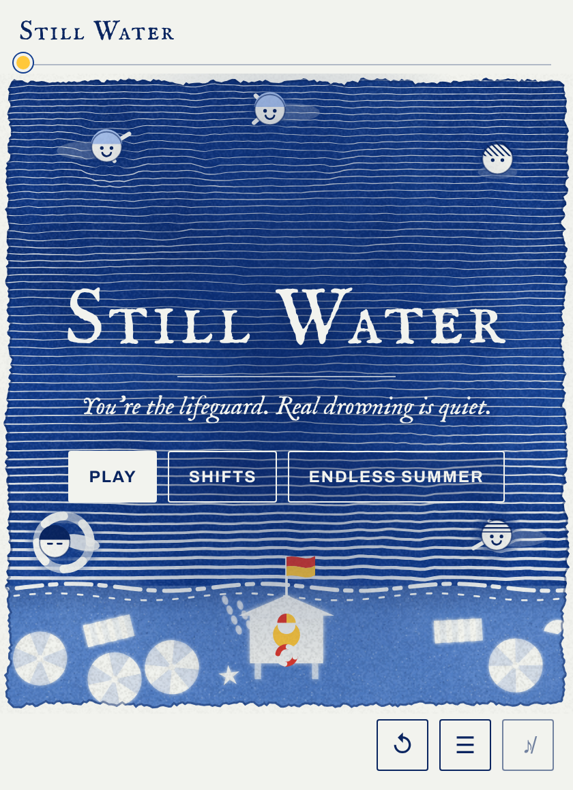
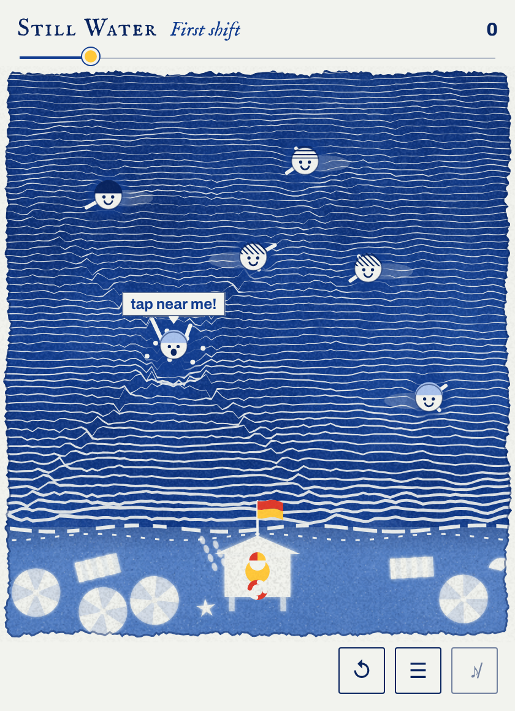
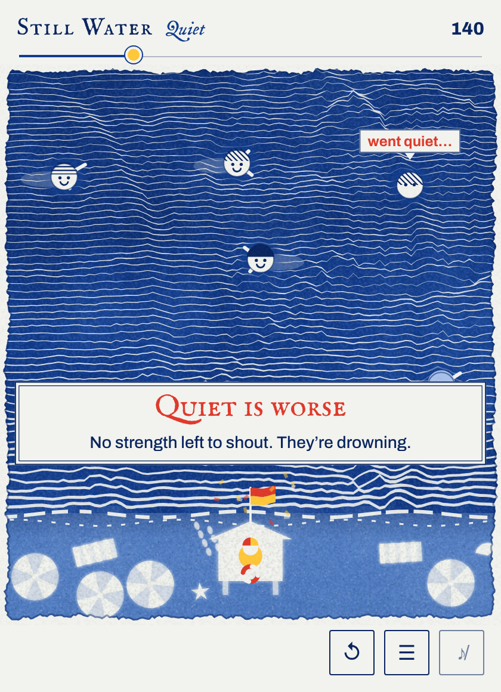
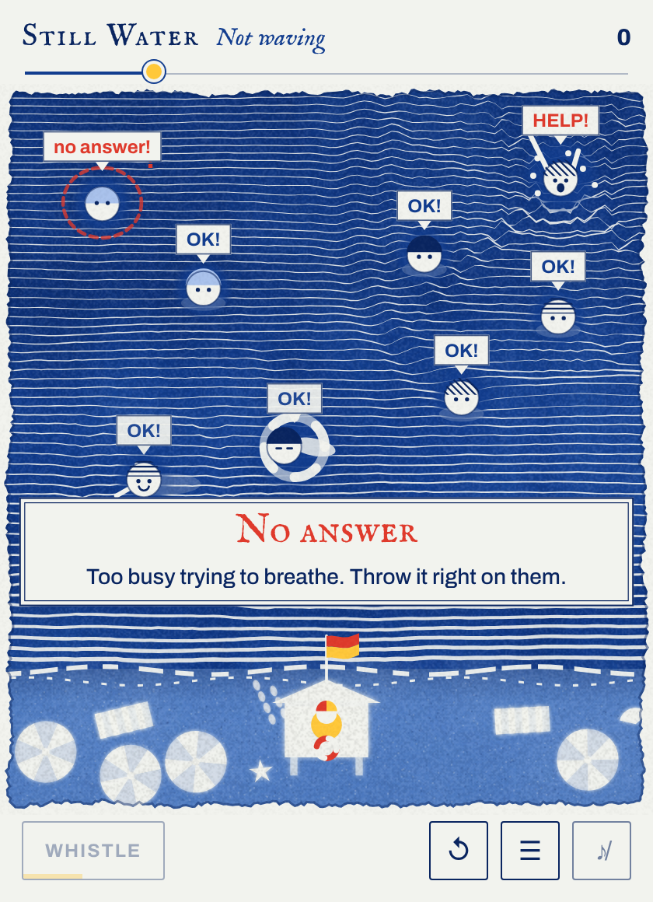
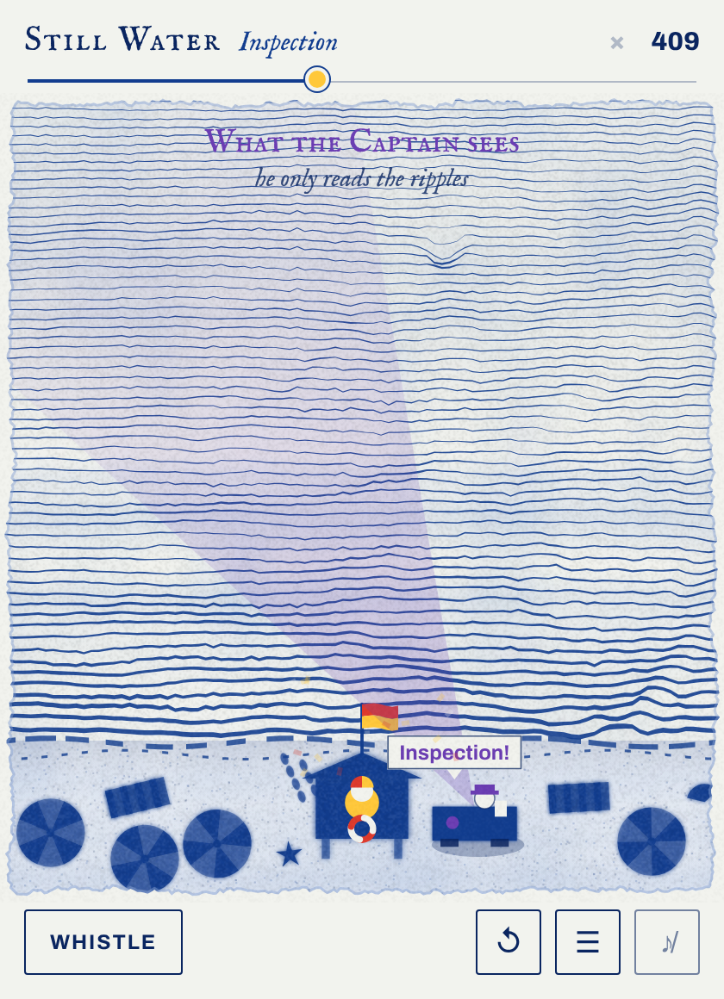
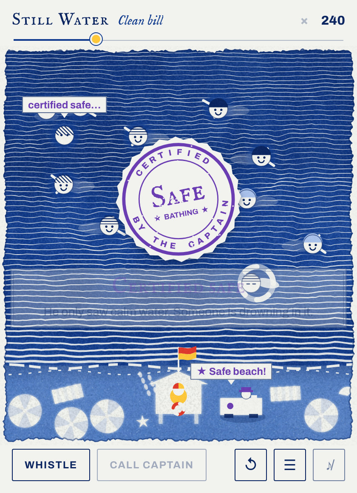

# STILL WATER

You're the lifeguard. Tap the water to throw a ring to anyone yelling for help. But real drowning is quiet.

A small game built around two concepts, and a third that appears when they combine:

- **Fold-back signal.** Some warning signals are produced by the very capacity whose loss they report. They rise
  with trouble, then go quiet when trouble disables their source. In the game, a struggling swimmer yells and
  splashes, then goes *quiet* when they run out of strength. Quiet is worse. Some people never make a sound at all:
  they look like someone calmly treading water. Your **whistle** is the probe: everyone who's fine waves back.
- **Refractory-check capture.** When passing a check buys immunity from the next one, the checked party gains by
  calling the check itself. In the game, the Captain inspects your beach, and anyone yelling while he looks is a
  strike. After a clean inspection he stays away for 20 seconds, so you **radio him in** at a calm moment of your
  choosing.
- **Certified collapse (emergent).** The Captain judges by noise, so the beach is easiest to certify when someone is
  drowning silently in it. During an inspection the screen shows only what he can see, the sound rings, and quiet
  swimmers vanish from the picture. Calm water passes. Calm isn't safe.

It looks like a cyanotype, a Prussian-blue sun print, and its sea is an engraving that listens. A live wave
simulation bends the engraved lines wherever someone splashes or shouts, so a swimmer drowning silently sits in
perfectly still lines. During an inspection the print flips to its negative: the Captain only reads the ripples.
([Why this look](docs/process-v2/13-cyanotype.md).)








**Put it in a LessWrong post:** paste [`dist/still-water-lw.html`](dist/still-water-lw.html) as plain text into a
Custom Widget block (steps in [`10-lesswrong-widget`](docs/process-v2/10-lesswrong-widget.md#inserting-it-by-hand-lesswrong-editor)).

**Play it:** open [`dist/still-water.html`](dist/still-water.html). It's one self-contained file, about 100 KB, and
works as a LessWrong post widget: sandboxed iframe, 340–700 px wide, auto height, no scroll trapping (on a phone,
swipes scroll the post until you tap the game). Nine shifts in three threads (*Quiet*, *The Captain*, *Calm water*),
plus *Endless summer*.

**Read about it:**
- [`docs/concepts.md`](docs/concepts.md): the concept write-ups (real cases, moves, nearest known ideas, honest
  novelty estimates).
- [`docs/process-v2/`](docs/process-v2/): the process log, from the concept search (about 560 candidates) through the
  first game (HUSH), its failure, and this redesign.
- [`docs/process-v2/solver-report.md`](docs/process-v2/solver-report.md): proof that each level is solvable with the
  game's ideas, still solvable for a slower, lazier human model, and unsolvable without them.

## Develop

```bash
node tools/build.js --page    # src/ -> dist/still-water.html, dist/still-water-lw.html (paste into LessWrong), + a standalone page
node tools/check-levels.js    # solver: every level solvable, and unsolvable under "ordinary" rules
node tools/endless-bots.js    # how long bots with and without the ideas last in Endless summer
node tools/e2e.js             # play every level through the real page with mouse clicks (needs Playwright)
python3 -m http.server 8765 &
node tools/harness-test.js .  # load the widget in a sandboxed iframe at 340/500/700 px
node tools/touch-test.js      # phone profile: swipes scroll the page until the reader taps the game
node tools/sw-shots.js 420 docs/screenshots
```

Sources are in `src/`. `logic.js` holds the rules shared by the game and the solver; `levels.js` the shifts;
`solver.js` the exhaustive checker. The first game, HUSH, is kept in [`legacy/hush/`](legacy/hush/).
